<div align="center">


# 🛠️ FileTools

**Lightweight, zero-config command-line toolkit to convert images, documents, and data formats, plus recursive ultra-fast file searching.**

[](https://github.com/anom-developer/filetools/actions/workflows/ci.yml)
[](https://github.com/anom-developer/filetools/releases/latest)
[](https://python.org)
[](https://github.com/anom-developer/filetools/releases/latest)
[](LICENSE)

<br/>

<a href="#-converter">
  
</a>

</div>

---

| Tool | Description |
|------|-------------|
| `filetools` | All-in-one unified entrypoint (`filetools converter ...` or `filetools searcher ...`) |
| `converter` | Converts files between formats: PNG↔JPG↔WebP↔ICO↔BMP↔GIF↔TIFF, TXT→PDF, JSON↔CSV, MD/HTML→TXT |
| `searcher` | Searches files by glob mask, regex, or content with context lines, size/date filters, and JSON output |

---

## ⬇️ Download & Installation

### Option 1 — Download standalone app (No Python required!)

Download pre-compiled binaries from [Releases](https://github.com/anom-developer/filetools/releases/latest):

| Platform | Download | Content |
|----------|----------|---------|
| 🖥️ Windows | [`filetools-windows-x86_64.zip`](https://github.com/anom-developer/filetools/releases/latest/download/filetools-windows-x86_64.zip) | `filetools.exe`, `converter.exe`, `searcher.exe` |
| 🐧 Linux | [`filetools-linux-x86_64.tar.gz`](https://github.com/anom-developer/filetools/releases/latest/download/filetools-linux-x86_64.tar.gz) | `filetools`, `converter`, `searcher` |
| 🍎 macOS | [`filetools-macos-x86_64.tar.gz`](https://github.com/anom-developer/filetools/releases/latest/download/filetools-macos-x86_64.tar.gz) | `filetools`, `converter`, `searcher` |

```cmd
# Windows (extract zip, then run directly):
filetools.exe --help
converter.exe photo.png photo.jpg
searcher.exe "*.py" .\src
```

```bash
# Linux / macOS:
tar -xzf filetools-linux-x86_64.tar.gz
./filetools --help
./converter --help
./searcher --help
```

### Option 2 — Automated Installer Script (Python 3.8+)

```cmd
# Windows (double-click or run in cmd):
install.bat
```

```bash
# Linux / macOS:
bash install.sh
```

### Option 3 — pip

```bash
# From GitHub:
pip install git+https://github.com/anom-developer/filetools.git

# From source:
git clone https://github.com/anom-developer/filetools.git
cd filetools
pip install -e .
```

---

## 🔄 Converter

### Supported formats

| Category | Source format | Target format | Notes |
|----------|---------------|---------------|-------|
| **Images** | PNG, JPG, JPEG, WebP, BMP, GIF, TIFF, ICO | Any image format | Auto-flattens transparency for JPEG/BMP, multi-res ICO generation |
| **Documents** | TXT | PDF | Full Unicode & Cyrillic support, auto system font discovery |
| **Data** | JSON | CSV | Supports arrays, single objects, and nested dict/list structures |
| **Data** | CSV | JSON | Auto-sniffs delimiter (`,`, `;`, `\t`, `\|`), optional type inference |
| **Markup** | Markdown (`.md`) | Plain Text (`.txt`) | Strips headings, bold, italic, code blocks, tables, links |
| **Web** | HTML (`.html`, `.htm`) | Plain Text (`.txt`) | Strips scripts/styles/tags, unescapes HTML entities |

### Examples

```bash
# Images
converter photo.png photo.jpg --quality 85
converter icon.png favicon.ico
converter photo.png thumb.png --resize 300x200
converter banner.jpg banner_half.jpg --resize 50%
converter scan.png scan_gray.png --grayscale
converter photo.jpg rotated.jpg --rotate 90

# Batch convert whole directory recursively
converter ./photos/ ./output/ --format webp --recursive

# Data & Documents
converter data.json data.csv
converter report.csv report.json --parse-types
converter notes.txt notes.pdf --font-size 14
converter document.html document.txt
```

### Options

```
positional:
  input               Input file or directory
  output              Output file or directory

optional:
  -f, --format FMT    Target format when converting directory (jpg, png, webp, ico, csv, txt)
  -r, --recursive     Recursively convert subdirectories, preserving folder structure
  -q, --quality N     Quality 1-100 for lossy formats JPEG/WebP (default: 90)
  --resize WxH|P%     Resize image: WIDTHxHEIGHT (e.g. 800x600) or percentage (e.g. 50%)
  --rotate DEG        Rotate image clockwise (90, 180, 270)
  --grayscale         Convert image to grayscale
  --font-size N       Body font size for TXT → PDF (default: 12)
  --font PATH         Path to custom .ttf font file for TXT → PDF
  --encoding ENC      Text file encoding (default: utf-8)
  --parse-types       Convert strings to numbers/booleans in CSV → JSON
  --no-overwrite      Skip conversion if target file already exists
  -v, --verbose       Show detailed progress output
  -h, --help          Show help message
```

---

## 🔍 Searcher

### Examples

```bash
# By glob mask
searcher "*.py" ./src

# By regex pattern
searcher --regex "report_\d{4}\.pdf" ./documents

# Search by content inside files with context lines
searcher --content "TODO" . --ext .py -C 2

# Filter by file size (min / max)
searcher "*.log" /var/log --min-size 1MB --max-size 100MB

# Filter by modification time (e.g. modified in last 7 days)
searcher "*.py" . --mtime -7d

# Exclude directories or file patterns
searcher "*.js" . --exclude "dist/*" "build/*"

# Include hidden files & virtualenvs (skipped by default)
searcher "*.env" . --hidden

# Output results as JSON for automation
searcher "*.json" ./config --json

# Only count matching files
searcher "*.csv" ./data --count
```

### Options

```
positional:
  pattern             Filename mask (e.g. '*.py') or regex. Defaults to '*' if --content is used
  path                Directory to search (default: current directory)

optional:
  -r, --regex         Treat pattern as regular expression
  -c, --content TEXT  Search inside file contents for text or regex
  -C, --context N     Show N lines of context before and after each content match
  -e, --ext EXT…      Filter by extension(s): --ext .py .txt
  -d, --depth N       Max recursion depth (default: unlimited)
  -i, --ignore-case   Case-insensitive matching for filenames and content
  --min-size SIZE     Minimum file size (e.g. 500B, 10KB, 2MB, 1GB)
  --max-size SIZE     Maximum file size (e.g. 50MB)
  --mtime TIME        Filter by time: -7d (last 7 days), +30d (older than 30 days), -24h
  --exclude PAT…      Exclude files/directories matching patterns
  -a, --hidden        Include hidden files and folders (e.g. starting with '.')
  --json              Output results in structured JSON format
  --count             Print only total count of matching files
  --no-color          Disable ANSI color formatting
  -o, --output FILE   Save results to file
  -v, --verbose       Show file size and modification date
  -s, --stats         Print search statistics at completion
  -h, --help          Show help message
```

---

## 🧪 Tests

FileTools includes an automated test suite covering all converters, transforms, filters, and CLI interfaces:

```bash
pip install -e ".[dev]"
pytest -v
pytest --cov=converter --cov=searcher --cov=filetools
```

---

## 📁 Project Structure

```
filetools/
├── README.md                  ← Documentation and usage guides
├── CHANGELOG.md               ← Version changelog
├── LICENSE                    ← MIT License
├── pyproject.toml             ← Build configuration & entrypoints
├── requirements.txt           ← Dependencies
├── install.bat                ← Windows auto-installer
├── install.sh                 ← Linux / macOS installer
├── create_release.bat         ← Windows release script
├── create_release.sh          ← Linux / macOS release script
├── .github/
│   └── workflows/
│       ├── ci.yml             ← CI test matrix (Python 3.8-3.13)
│       └── release.yml        ← Multi-platform release builder (Win/Linux/Mac)
├── filetools/                 ← Unified CLI
│   ├── __init__.py
│   ├── __main__.py
│   └── cli.py
├── converter/                 ← File converter
│   ├── __init__.py
│   ├── __main__.py
│   ├── cli.py
│   ├── core.py
│   └── formats/
│       ├── images.py          ← Image conversions & transformations
│       ├── documents.py       ← TXT → PDF with Unicode support
│       └── data.py            ← JSON, CSV, Markdown, HTML conversions
├── searcher/                  ← Recursive file searcher
│   ├── __init__.py
│   ├── __main__.py
│   ├── cli.py
│   ├── core.py                ← Directory walk, regex, size/time filters
│   └── output.py              ← Color formatting, context lines, JSON
└── tests/
    ├── conftest.py
    ├── test_cli.py
    ├── test_converter.py
    └── test_searcher.py
```

---

## 📄 License

MIT License — see [LICENSE](LICENSE).
